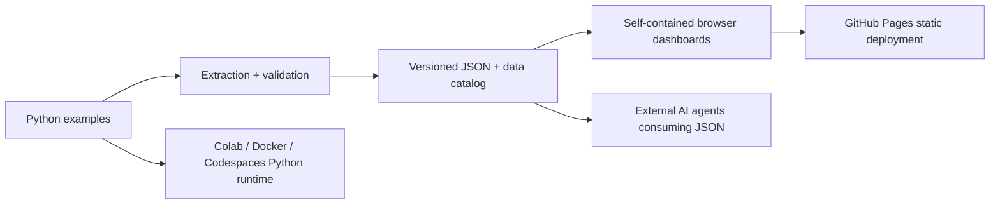

# ◈ Python Data-Driven Visualization Journey

<p align="center"><strong>Interactive dashboards · Construction analytics · Smart home · Data storytelling</strong></p>
<p align="center"></p>
<p align="center">
<a href="site/index.html">▶ Open offline portfolio</a> ·
<a href="site/api/catalog.json">◉ Machine-readable catalog</a> ·
<a href="docs/AUDIT_PAGES_AI_READINESS_2026-10-19.md">▣ Audit and roadmap</a>
</p>

> **Review branch / em auditoria:** new static pages are a proposed revision, not yet confirmed as publicly deployed. Historical construction/smart-home numbers are illustrative examples, **not validated real expenses, savings or model results**.

## 🎯 Three progressive learning tracks

| Version | Focus | Static demo | Python source |
|---|---|---|---|
| **V1 — Hierarchical storytelling** | Sunburst, budget breakdown, traceability | [View](site/dashboard_v1.html) | [Legacy V1](dashboards/v1_simple/sunburst_cost_explorer_funcional.py) |
| **V2 — Construction costs** | Cascading filters, budget deviation, export | [View](site/dashboard_v2.html) | [V2 source](dashboards/v2_construction/V2_script.py) |
| **V3 — Smart Home** | Geographic, investment/savings relations, ML caveats | [View](site/dashboard_v3.html) | [V3 source](dashboards/v3_smart_home/Plan_V3_funcional.py) |

### 📊 Traceable source KPIs (illustrative)
| V2 fact | Reconciled value |
|---|---:|
| Line items | 49 |
| Cost | US$ 3,085,000 |
| Budget | US$ 2,988,000 |
| Difference | US$ 97,000 |
| V3 observations | 10 |

The existing Python V2 and static V2 pages diverged considerably; this review version embeds **Python V2** source values. V1 is rebuilt using the V2 hierarchy because its original arrays have mismatched lengths.

## 🧭 Architecture



### 🔌 External AI / automation

AIs can retrieve source and structured data from [`site/api/catalog.json`](site/api/catalog.json); evaluate with [`scripts/validate_portfolio.py`](scripts/validate_portfolio.py). The browser pages are 100% client-side. **GitHub Pages does not execute Python, Dash or external agents on the server.** External agents should run in their own infrastructure; API keys remain server-side.

```bash
python scripts/validate_portfolio.py
python -m http.server 8000 --directory site
# Open http://localhost:8000/
```

For legacy Dash (separate runtime):
```bash
python -m venv .venv
source .venv/bin/activate
pip install -r requirements.txt
python dashboards/v3_smart_home/Plan_V3_funcional.py
```
*Historical dependencies and entrypoints need compatibility tests on the target Python environment.*

## 🚀 Publishing

After PR review: repository **Settings → Pages → Build and deployment → GitHub Actions**. Workflow `.github/workflows/pages.yml` uploads only `site/` after validation and only on pushes to `main`. A preview branch by itself does not publish.

## 📚 Documentation

- [Audit findings and implementation gates](docs/AUDIT_PAGES_AI_READINESS_2026-10-19.md)
- [Original installation guide](COMO_EXECUTAR.md)
- [Legacy release notes](RELEASE_NOTES.md)
- [Plotly learning guides](ai_learning_guides/)
- [Errors and lessons learned](error_reports/)

**EN** — A reproducible educational portfolio with three interactive static dashboard variants. Data labels and limitations are deliberate; predictive claims need independent evaluation. Open a draft PR and require CI checks before merging.

**PT-BR** — Portfólio didático reprodutível, com três dashboards estáticos e dados documentados. A `main` permanece intacta até a aprovação da revisão.
