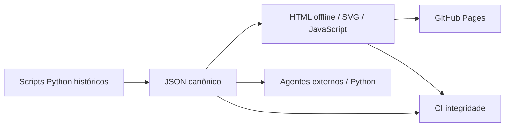

# ◈ Python Data-Driven Visualization Journey

> **From raw Python explorations to transparent, reproducible interactive dashboards.**
>
> [🇧🇷 Português](#visão-geral) · [🇺🇸 English](#english-overview) · [Dashboards](#dashboards) · [Reproduce](#reproduzir-e-auditar)


## Visão geral

Três estudos evolutivos de visualização de dados: **V1** (estrutura hierárquica de custos), **V2** (comparativo entre orçamento e realizado) e **V3** (smart-home, dados geográficos e análise exploratória).

O site estático incorpora **49 registros de construção** e **10 instalações ilustrativas**, extraídos dos arquivos Python do histórico do projeto. A origem é rastreável em `data/manifest.json`.

## Dashboards

| Dashboard | Problema | Visualização | Interface |
| --- | --- | --- | --- |
| **V1 · Hierarchy** | Quais áreas concentram custos? | Composição radial + filtros | [Abrir](./index.html#v1) |
| **V2 · Construction** | Onde o custo se distancia do orçamento? | Barras + tabela + CSV | [Abrir](./index.html#v2) |
| **V3 · Smart Home** | Como variam instalações e economia? | Dispersão + localização | [Abrir](./index.html#v3) |

**[▶ Abrir o portfólio interativo](./index.html)**

> **Nota de transparência:** os dados são exemplos presentes nos scripts históricos. Não são medições auditadas, custos comprovados ou evidência de validade preditiva. A V1 histórica tem hierarquia inconsistente; esta reconstrução usa a fonte reconciliada do V2.

## Arquitetura



## Reproduzir e auditar

```bash
git clone https://github.com/Genovese-Felipe/Python-Data-Driven-Visualization-Journey.git
cd Python-Data-Driven-Visualization-Journey
python tools/validate_site.py
python -m http.server 8000
# navegue até http://localhost:8000/ (na branch de revisão)
```

Os servidores Dash históricos continuam em `dashboards/`, mas suas dependências e comportamentos precisam de modernização e testes antes de uso em produção. Consulte [Guia de agentes externos](./docs/AI_EXECUTION.md).

## English overview

This portfolio combines three iterations of Python data visualization into one browser-side, self-contained site. Canonical datasets and provenance metadata are available as versioned JSON. **All values are illustrative and should not be interpreted as verified real-world costs or validated model outputs.** Changes follow a PR-based review workflow.

## Roadmap

- [x] Branch isolada e fontes JSON rastreáveis
- [x] HTML offline interativo e validação de paridade
- [ ] Testes funcionais end-to-end e acessibilidade completos
- [ ] Reconciliar as 97 etiquetas da hierarquia V1 histórica
- [ ] Corrigir scripts legados e notebooks com falhas
- [ ] Revisar, aprovar PR e publicar o site

**License:** consulte `LICENSE`. *O README original foi preservado: este é um candidato para revisão editorial, não uma substituição já aprovada.*
