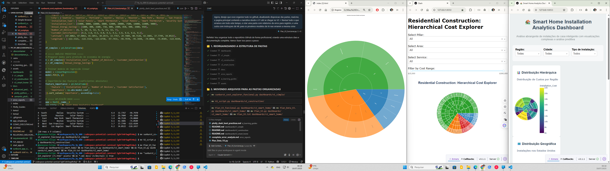

<!-- REVIEW PROPOSAL: this file is not the live root README.md. Merge only after source/data QA. -->
<div align="center">

# ◈ FGen Labs — Data Visualization Journey
### From raw data to reliable decisions · Dos dados brutos às decisões rastreáveis

**Python · Plotly · Dash · Data Storytelling · ML Validation**

[](https://www.python.org/)
[](docs/audits/2026-10-19/AUDIT_AND_MIGRATION_PLAN.md)
[](docs/audits/2026-10-19/AUDIT_AND_MIGRATION_PLAN.md)

**[🇧🇷 Português](#-português)** · **[🇺🇸 English](#-english)** · **[Technical audit](docs/audits/2026-10-19/AUDIT_AND_MIGRATION_PLAN.md)**

</div>

---

## 🇧🇷 Português

### Três dashboards. Uma jornada de evolução.

| Versão | Objetivo | Demonstração atual | Código |
|---|---|---|---|
| 🌐 **01 — Hierarquia** | Decomposição de custo / sunburst | [Abrir HTML original](index/dashboard_v1.html) | [Dash V1](dashboards/v1_simple/sunburst_cost_explorer_funcional.py) |
| 🏗️ **02 — Construção** | Filtros e comparações de orçamento | [Abrir HTML original](index/dashboard_v2.html) | [Dash V2](dashboards/v2_construction/V2_script.py) |
| 🏠 **03 — Smart Home** | Geodados e ML exploratório | [Abrir HTML original](index/dashboard_v3.html) | [Dash V3](dashboards/v3_smart_home/Plan_V3_funcional.py) |

> **Estado da revisão (19/10/2026):** dados ilustrativos, protótipo educacional. A página V2 e o script Python produzem totais divergentes; o V1 possui listas de hierarquia inconsistentes; o V3 contém um modelo treinado sobre somente 10 exemplos, sem validação relatada. **Os links acima são do acervo histórico e ainda não representam a versão corrigida.**

### Prévia da evolução



A imagem registra o desenvolvimento histórico. Não deve ser utilizada como prova de funcionamento da versão atual, segurança ou precisão estatística.

### Executar localmente

```bash
git clone https://github.com/Genovese-Felipe/Python-Data-Driven-Visualization-Journey.git
cd Python-Data-Driven-Visualization-Journey
python -m venv .venv
# Linux/macOS: source .venv/bin/activate
# Windows PowerShell: .venv\Scripts\Activate.ps1
python -m pip install -r requirements.txt
python dashboards/v1_simple/sunburst_cost_explorer_funcional.py
# Em outro processo:
python dashboards/v2_construction/V2_script.py
# Em outro processo:
python dashboards/v3_smart_home/Plan_V3_funcional.py
```

**Compatibilidade pendente de validação em CI:** as dependências atuais foram fixadas em versões antigas; os scripts V2 e V3 originais usam modo Jupyter inline, que pode não ser apropriado como servidor web independente.

### Qualidade dos dados

| Base | Tipo | Registros | Total | Situação |
|---|---|---:|---:|---|
| Python V2 | Exemplo codificado | 49 | US$ 3.085.000 de custo | Referência de reconciliação |
| HTML V2 | Resumo divergente codificado | 23 | US$ 4.730.000 de custo | Requer correção |
| Smart Home V3 | Exemplo simulado | 10 | — | Sem inferência externa |

### Publicação via GitHub Pages

O GitHub Pages hospedará **HTML estático**, não o servidor Dash. A publicação recomendada usa Actions com artefato `_site/`, depois de validação de paridade de dados e smoke tests. [Leia o plano com critérios de aceite.](docs/audits/2026-10-19/AUDIT_AND_MIGRATION_PLAN.md)

### Próximas entregas

- [ ] Dataset canônico e rastreabilidade de custos
- [ ] Árvore sunburst corrigida e testes de reconciliação
- [ ] Export HTML offline reproduzível
- [ ] Avaliação estatística do ML (ou remoção das alegações preditivas)
- [ ] Build de Pages e testes de acessibilidade
- [ ] Revisão/merge com `main` protegida

---

## 🇺🇸 English

**Three dashboards, one reproducible learning journey:** hierarchical construction costs (V1), financial controls (V2), and illustrative smart-home analytics (V3).

**Data integrity warning:** these are educational/demo datasets; original V2 Python and HTML totals differ substantially, V1 hierarchy arrays require repair, and V3's 10-row regression model is not independently validated. Historical demos should not be represented as audited production output.

**Publishing:** GitHub Pages hosts static HTML/JS/CSS, not Python/Dash servers. The proposed pipeline builds from one canonical data source, validates totals and filters, produces standalone HTML, runs UI tests, and deploys through GitHub Actions only after approval.

See the [audit and migration plan](docs/audits/2026-10-19/AUDIT_AND_MIGRATION_PLAN.md) before merging. The original `README.md` remains unchanged during review.

---

<sub>Maintained as an educational project. Source audit baseline: `859aa2882b290268d46d7027b4eb437cb844914b`.</sub>
