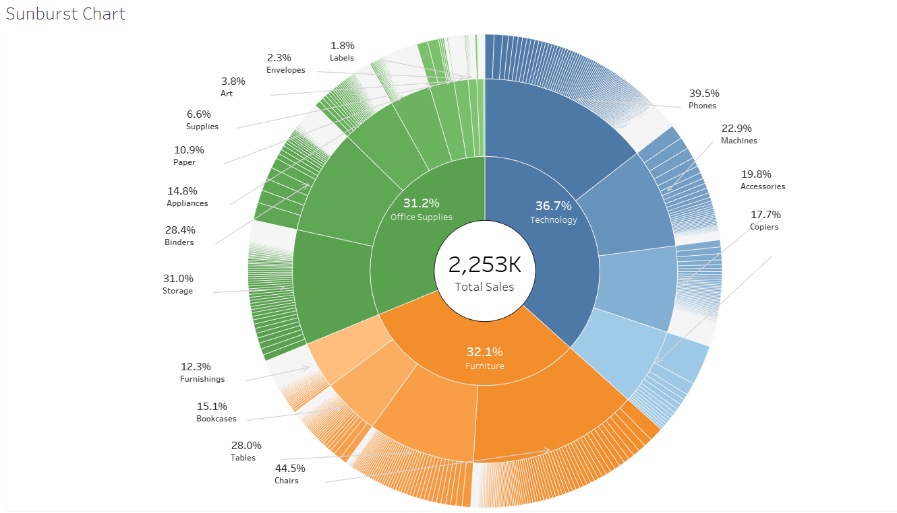
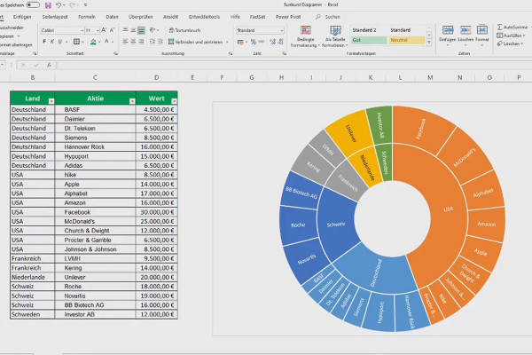
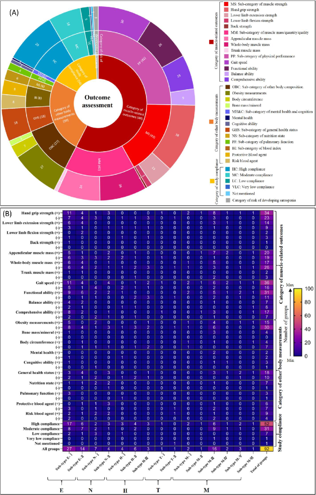

# 📊 Python Data-Driven Visualization Journey

<div align="center">

**Visual analytics • EDA • Plotly / Dash • Data storytelling • Learning by building**


**Explore the evolution from a hierarchical sunburst to budget analysis and smart-home visualization.**

[Repository](https://github.com/Genovese-Felipe/Python-Data-Driven-Visualization-Journey) ·
[Visual journey](docs/visual_journey.md) ·
[Audit and roadmap](docs/AUDITORIA_PAGES_2026-10-19.md) ·
[Contributing](docs/CONTRIBUTING.md)

</div>

---

## 🖥️ Dashboards / Experiências

| Version | Focus | Local (Dash) | Browser-first |
|---|---|---|---|
| **V1** | Sunburst and KPI fundamentals | `python dashboards/v1_simple/sunburst_cost_explorer_funcional.py` · port **8052** | [Static V1](index/dashboard_v1.html) |
| **V2** | Construction cost, budgets and filters | `python dashboards/v2_construction/V2_script.py` · *Jupyter-specific execution, review needed* | [Static V2](index/dashboard_v2.html) |
| **V3** | Smart-home installations, geography and illustrative ML | `python dashboards/v3_smart_home/Plan_V3_funcional.py` · port **8053** | [Static V3](index/dashboard_v3.html) |

**Open the [portfolio landing page](index/principal.html)** in a browser after downloading this repo. GitHub Pages publication is configured by the proposed workflow; confirm deployment status in GitHub Actions before treating the public URL as live.

> ⚠️ **Data integrity.** V1, V2, V3 and the V006 notebook contain different illustrative datasets. The V2 static HTML contains 23 services totaling **US$ 4,730,000** realized vs. **US$ 4,557,000** budget; the V006 example totals **US$ 3,085,000**. V3 contains synthetic installations; feature importance displayed in the historical HTML is not evidence of a validated model.

## ✨ Visual references

| Hierarchy | Scientific visualization | Dashboard storytelling |
|:---:|:---:|:---:|
|  |  |  |


## ⚡ Quick start (provisional)

```bash
git clone https://github.com/Genovese-Felipe/Python-Data-Driven-Visualization-Journey.git
cd Python-Data-Driven-Visualization-Journey
python3.11 -m venv .venv
source .venv/bin/activate  # Windows: .venv\Scripts\activate
python -m pip install -r requirements.txt
python dashboards/v1_simple/sunburst_cost_explorer_funcional.py
```

Visit `http://localhost:8052`. Existing pins need CI verification; do not assume Python 3.12/3.13 compatibility without testing.

## 🧭 Repository map

```text
index/                Existing HTML dashboards and landing page
dashboards/v1_simple/ Sunburst Dash application
dashboards/v2_construction/ Cost explorer / interactive filters
dashboards/v3_smart_home/ Smart-home demo and analytics
v006_rvw.ipynb        Iterative research notebook (historical, not clean run)
python-colab.ipynb    Exploratory Python notebook
Python_colab_tutorial_Part_1_V001.ipynb   Tutorial
docs/                 Technical references, guides, review
assets/               Reference images and screenshots
error_reports/        Historical problem analysis
ai_learning_guides/   Prompting, plotting design patterns
requirements.txt      Legacy pinned Python dependencies
```

## 📈 Review → Stabilize → Publish

- [x] Catalog actual repository files and pre-existing website
- [x] Prepare GitHub Pages workflow in an isolated review branch
- [ ] Refactor notebooks for deterministic execution and CI
- [ ] Separate provenance of V1/V2/V3 datasets and add manifest
- [ ] Replace CDN-only HTML with bundled offline Plotly
- [ ] Add validated ML evaluation, regression tests, visual snapshots
- [ ] Document releases and accessibility testing

## 🌐 GitHub Pages

**Settings → Pages → Source → GitHub Actions**, then merge an approved PR. The suggested workflow stages `index/principal.html` as `index.html` and preserves all three dashboard paths. Draft PR builds do not deploy.

## 🇧🇷 / 🇺🇸

**PT:** laboratório de visualização e ciência de dados que registra experimentos, erros, refatorações e avanços em três experiências interativas. Dados demonstrativos identificados; portfólio com rastreabilidade técnica.

**EN:** an evidence-oriented visualization lab documenting experiments, failures, refactors, and evolution across three dashboards. Illustrative datasets clearly labeled, code-to-browser traceability prioritized.

## 📜 License

MIT · Felipe de Azevedo Marques Genovese. Images and third-party assets require individual provenance review before republication.
