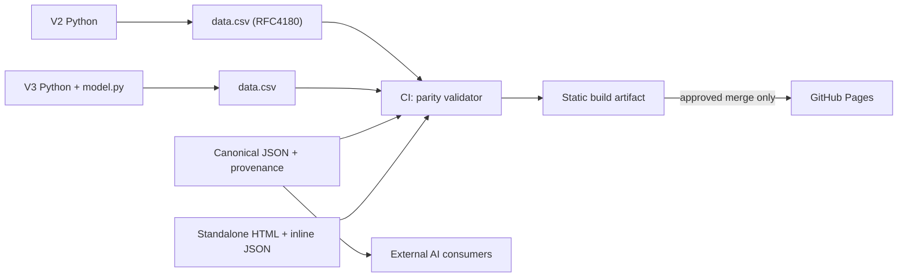

# Conciliação de versões e implementação — main de 19/10/2026

## Snapshot e concorrência

- Snapshot original (16/08/2025 UTC): `859aa2882b290268d46d7027b4eb437cb844914b` — 53 arquivos.
- **Main mais recente observada:** `20486531a623c48e99bf6e529e13c28155b56603` — 62 arquivos, com os merges #8 e #4.
- A branch inicial `audit/pages-consolidation-20261019` foi preservada como **snapshot histórico desatualizado** após a alteração concorrente da main.
- **Branch correta para revisão:** `review/pages-data-integrity-20261019`, criada diretamente a partir da nova main; ainda não houve merge desta revisão na main.

## Regressões confirmadas após os merges

| ID | Arquivo | Observação | Implementação na branch |
|---|---|---|---|
| R01 | `dashboards/v2_construction/data.csv` | 8 de 49 linhas têm 8 ou 9 campos, apesar de cabeçalho de 7, em virtude de vírgulas não escapadas | CSV corrigido com aspas RFC 4180; mesma ordenação e valores |
| R02 | `dashboards/v2_construction/V2_script.py` | `read_csv('dashboards/...')` dependia do diretório de trabalho | Resolução por `Path(__file__).resolve().with_name('data.csv')` |
| R03 | `dashboards/v3_smart_home/Plan_V3_funcional.py` | Import relativo `from .model` falha em execução direta como script | Import condicional de pacote/script e caminho relativo ao arquivo |
| R04 | `dashboards/v3_smart_home/model.py` | DataFrame de importância tem `importance`, mas o gráfico utiliza `feature` | Incluída coluna `feature`; ressalva de coeficientes não padronizados |
| R05 | V1 | Continuava com listas de 97 `labels`, 97 `parents` e 53 `values` | Reconstrução do V1 com hierarquia de 49 registros/5 níveis do CSV validado |
| R06 | V2 tooltip | Template de Plotly continha expressão não suportada `%{(customdata[0] - customdata[1])}` | Hover agora apresenta `%{value}` e `%{percentParent}` confiáveis |
| R07 | GitHub Pages | Workflow de main publica `index/principal.html` como índice | A revisão publica o novo `index.html`; a versão antiga permanece em `/legacy/` |
| R08 | CI | Build da main não verificava integridade CSV/JSON/HTML | Novo `tools/validate_site.py` incorporado ao workflow de PR e deploy |

## Arquitetura efetivamente implementada na branch de revisão

**Públicos externos:** o JSON permite leitura por scripts Python, JavaScript e agentes IA sem rodar Dash. O Dash continua disponível para execução externa em ambiente Python, mas o Pages não oferece Python server-side. Nenhum segredo foi adicionado ao site.

## Critérios de aceite antes do merge

- [ ] GitHub Actions verde: `validate-static`, com paridade de 49 linhas V2, 10 V3, IDs, totais e HTML.
- [ ] Executar `V1`, `V2` e `V3` em ambiente isolado com dependências testadas; confirmar callbacks e figuras sem exceção.
- [ ] Testar o **novo HTML da branch** no Chromium (desktop e celular), navegação, CSV, teclado e contraste.
- [ ] Conferir HTML novo versus Python V2 e V3 em valores e agregações.
- [ ] Não publicar afirmações de dados reais, modelos validados, payback financeiro ou causalidade.
- [ ] Conferir licenças das quatro imagens históricas antes de incluí-las no Pages (o deploy atual não inclui as imagens).
- [ ] Exigir PR review e proteção de `main`.
- [ ] Conferir configuração de Pages (Settings → Pages → Source: GitHub Actions) após merge aprovado.

## Próxima rodada

1. Refatorar modelos ML com baseline, validação externa/LOOCV e explicações de variáveis contínuas.
2. Reexecutar notebooks: `Python_colab_tutorial_Part_1_V001.ipynb` (1 erro armazenado), `python-colab.ipynb` (2 erros), `v006_rvw.ipynb` (3 erros).
3. Testar todos os scripts históricos e migrar caminhos absolutos, `debug=True` e versões legadas; não bloquear a publicação do HTML independente se o escopo de produção estiver explicitamente limitado à interface estática.
4. Adotar e fundir `README_NEXT.md` e `README_VISUAL_PROPOSTA.md` por revisão editorial; o README original permanece intacto.
5. Separar versão e proveniência dos dados demonstrativos versus futuras fontes públicas reais.

**Importante:** nenhum workflow foi executado por esta documentação. A implantação só é considerada concluída após um job de deploy bem-sucedido e verificação da URL pública.
