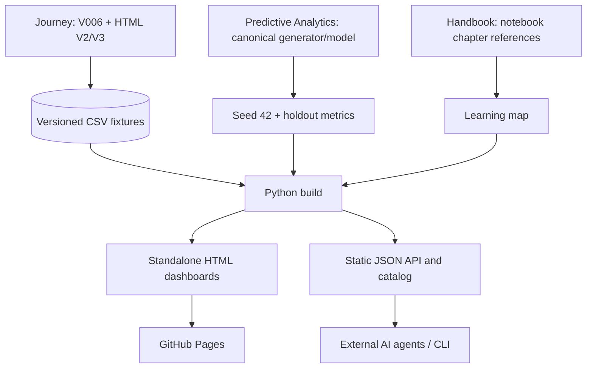

# FGen Visual Analytics Lab · Unified portfolio

> **One data contract, multiple visualizations, reproducible ML, offline-first publishing, agent-friendly JSON.**

   

## Explore five integrated modules

| Module | Focus | Offline HTML |
|:--|:--|:--|
| **01 · Hierarchical costs** | Sunburst: pillar → area → service → task | [V1](site/dashboard_v1.html) |
| **02 · Construction budgets** | Actual versus budget (distinct historical fixture) | [V2](site/dashboard_v2.html) |
| **03 · Smart home** | Geography, installation cost and simulated energy savings | [V3](site/dashboard_v3.html) |
| **04 · Predictive PMO** | 240 seeded synthetic projects; Random Forest, holdout | [V4](site/dashboard_v4.html) |
| **05 · Learning map** | Five foundation chapters linked to PythonDataScienceHandbook | [Learning map](site/learning_map.html) |

The generated site is in `vizlab/site/` **after running the build**. Source HTML is not tracked; GitHub Actions generates it. This removes 4–5 MB of Plotly code from every pull request diff.

## Quickstart

```bash
git clone https://github.com/Genovese-Felipe/Python-Data-Driven-Visualization-Journey.git
cd Python-Data-Driven-Visualization-Journey
python -m venv .venv
source .venv/bin/activate  # Windows: .venv\Scripts\Activate.ps1
python -m pip install -r vizlab/requirements.txt
python vizlab/build.py validate
python vizlab/build.py build
python -m http.server -d vizlab/site 8000
```

Open `http://localhost:8000`. For a single-file offline experience, open `vizlab/site/dashboard_v1.html` or another exported dashboard directly; each page embeds Plotly and does not depend on a CDN.

## Architecture



## API and AI execution

No privileged API calls or arbitrary code evaluation is required. The portfolio is static; external agents consume published `catalog.json`, `api/v1.json`, `api/v2.json`, `api/v3.json`, `api/v4.json` and model-metrics JSON. For headless execution:

```bash
python vizlab/build.py catalog
python vizlab/build.py validate
python vizlab/build.py build
```

These commands return JSON on stdout (and non-zero exit on validation errors). External services can trigger an allowlisted GitHub Actions `workflow_dispatch` after the approved PR is merged. The GitHub Pages host **cannot** run Python or arbitrary AI-generated code.

## Data provenance and limitations

**Do not add or reconcile unlike datasets.** V1 uses 23 V006 notebook records (USD 3,085,000). V2 has 23 different construction budget records (USD 4,730,000 actual and USD 4,557,000 budget). V3 has 10 synthetic smart-home observations (USD 131,500 in total installation costs). V4 is a separately seeded 240-project dataset generated from the canonical second repository.

Model metrics are on an 80/20 holdout from synthetic data, **not** operational predictive validation. Do not present as deployed ML, customer data, forecast accuracy, or cost reality.

## Sources and audit

- [Visualization Journey](https://github.com/Genovese-Felipe/Python-Data-Driven-Visualization-Journey)
- [Predictive Analytics Dashboard](https://github.com/Genovese-Felipe/Python-Data-Plotly-Predictive-Analytics-Dashboard)
- [PythonDataScienceHandbook](https://github.com/Genovese-Felipe/PythonDataScienceHandbook)
- [Frozen full file-level inventory](audit/FILE_INVENTORY_3_REPOS.csv) · [Metadata manifest](audit/inventory_manifest.json)
- [Source and license attribution](DEPENDENCY_LINEAGE.md)

**Quality gate:** no direct pushes to `main`. Audit + build + tests + review + approved merge precede any Pages deployment. Binary assets, third-party books and historical PDFs remain links or catalog entries rather than vendored into this runtime.
